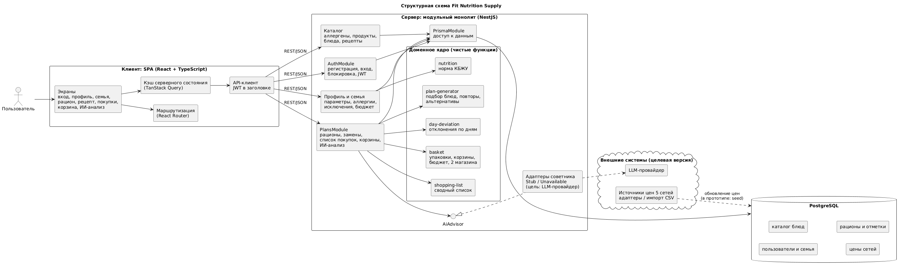
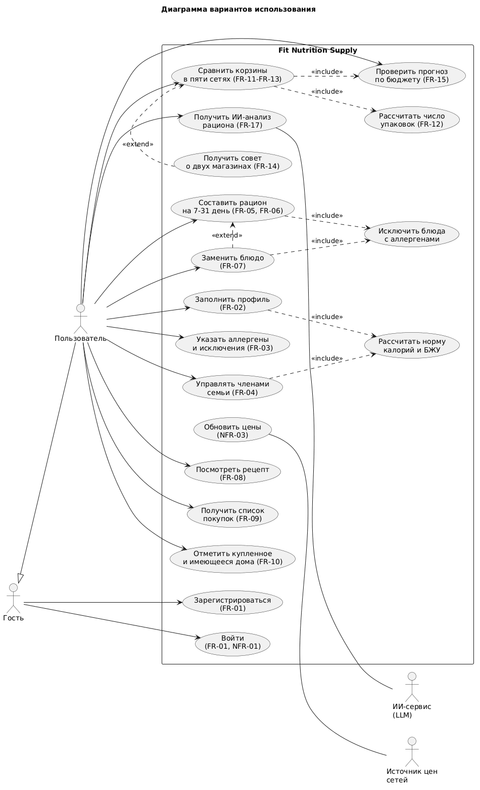
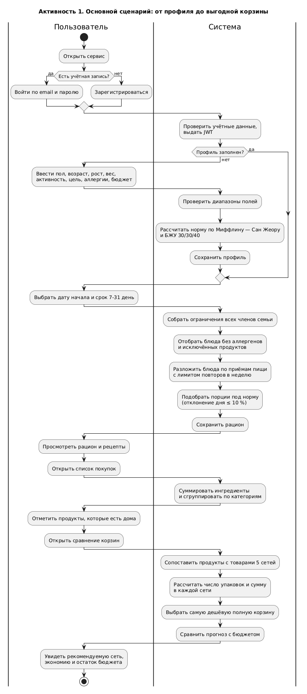
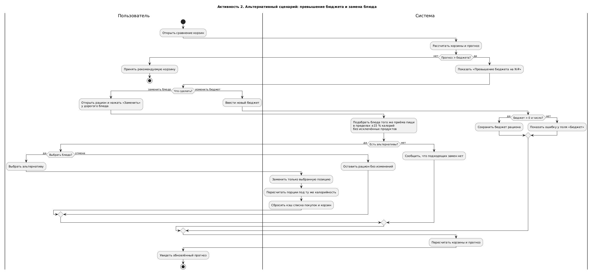
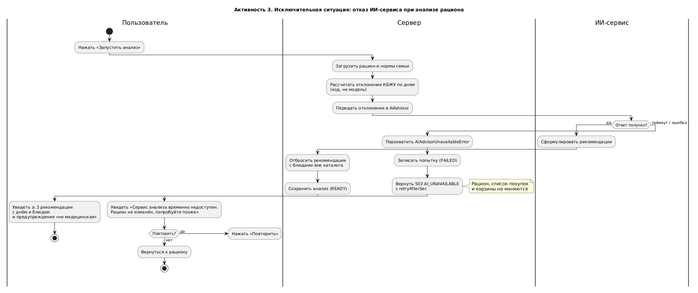
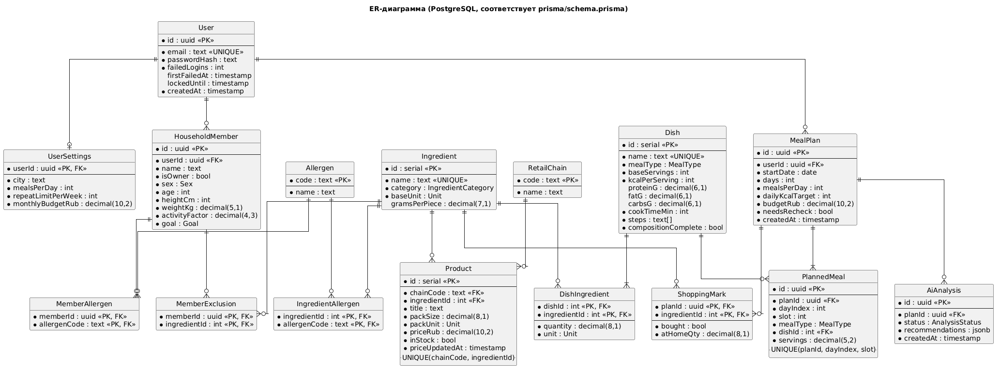

# Архитектура Fit Nutrition Supply

Лабораторная работа № 2 «Архитектура и интерактивный прототип в коде». Команда: Чипига А. А., Фазлыев А. А., группа Б23-191-2.

Документ опирается на спецификацию из ЛР 1: 16 User Stories, FR-01…FR-21 и NFR-01…NFR-05. Номера требований ниже ссылаются на неё. Исходники диаграмм лежат рядом в `diagrams/*.puml` (PlantUML), картинки собраны из них.

## 1. Структурная схема

Система состоит из трёх подсистем: браузерного клиента, сервера приложений и базы данных. Две внешние системы, цены сетей и языковая модель, подключаются через адаптеры. В прототипе вместо них работают заглушки.

**Клиент** — одностраничное приложение на React. Экраны соответствуют wireframe-ам из [wireframes.md](wireframes.md). Состояние, полученное с сервера (профиль, рацион, список покупок, корзины), хранится в кэше TanStack Query. После замены блюда кэш списка и корзин сбрасывается, и их данные перезапрашиваются. Своих расчётов клиент не делает. Он показывает то, что вернул сервер, и отправляет действия пользователя.

**Сервер** — модульный монолит на NestJS, выбор обоснован в [ADR-001](adr/ADR-001-architecture-style.md). Модули отвечают за предметные области:

- `AuthModule` регистрирует и аутентифицирует пользователя, выдаёт JWT и блокирует вход после пяти неудачных попыток (FR-01, NFR-01). Глобальный guard пропускает к остальным маршрутам только запросы с действующим токеном.
- Профиль и семья хранят параметры тела, цель, аллергены, исключённые продукты и бюджет. Через доменную функцию `nutrition` они рассчитывают норму каждого члена семьи и общую норму (FR-02…FR-04).
- Каталог отдаёт справочники аллергенов и продуктов, а также карточку рецепта с пересчётом на нужное число порций (FR-08).
- `PlansModule` — самый крупный модуль. В нём собраны генерация рациона и замена блюд (`PlansService`), а также всё, что выводится из готового рациона: список покупок, корзины по сетям, проверка бюджета и ИИ-анализ (`PlanInsightsService`).

Вычисления вынесены в **доменное ядро** — набор чистых функций без зависимостей от Nest и Prisma: `nutrition`, `plan-generator`, `shopping-list`, `basket`, `day-deviation`. Сервисы загружают данные, передают их в ядро и сохраняют результат. Такое разделение позволило покрыть критерии приёмки из ЛР 1 юнит-тестами на тех же числах, что в спецификации (норма 2345 ккал, 700 г → 2 упаковки по 500 г, экономия 30 ₽ и т. д.).

ИИ-анализ спрятан за портом `AiAdvisor`. Сервис рационов не знает, что стоит за портом: настоящая модель, заглушка или имитация отказа. Решение описано в [ADR-005](adr/ADR-005-ai-integration.md).

**База данных** — PostgreSQL, доступ через Prisma ([ADR-002](adr/ADR-002-data-storage.md)). Модель данных приведена в разделе 4.

## 2. Технологический стек

| Слой | Технологии |
|---|---|
| Язык | TypeScript (клиент и сервер) |
| Клиент | React 19, Vite 8, React Router 7, TanStack Query 5, собственные CSS-стили без UI-библиотеки |
| Сервер | Node.js 22, NestJS 12, zod 4 (валидация через `StandardSchemaValidationPipe`), `@nestjs/jwt`, bcryptjs |
| Данные | PostgreSQL 17, Prisma ORM 7 с драйвер-адаптером `@prisma/adapter-pg`, миграции Prisma Migrate |
| Тесты | Vitest 4 (юнит-тесты доменного ядра), Supertest (e2e-тест API на живой БД) |
| Инфраструктура | Docker Compose для PostgreSQL |
| Документация | PlantUML (UML, ER, Salt-wireframe-ы), Markdown |

## 3. Диаграммы UML

### 3.1 Варианты использования

У системы два основных актора. Гость может только зарегистрироваться или войти. Пользователь работает со всем сценарием, от профиля до сравнения корзин. Вторичные акторы — ИИ-сервис, к которому сервер обращается при анализе рациона, и источник цен сетей. Расчёт нормы и фильтрация блюд по аллергенам не вызываются пользователем напрямую: они входят в несколько вариантов использования через `include`. Совет купить продукты в двух магазинах (FR-14) расширяет сравнение корзин и появляется, только если экономия не меньше 200 ₽. Оформление и оплата заказа (FR-20, FR-21) имеют приоритет Won't и на диаграмму не попали.

### 3.2 Диаграммы активности

Для команды из двух человек нарисованы три сценария.

**Основной сценарий** проходит минимальный работающий путь из раздела MoSCoW ЛР 1: вход, профиль, рацион, список покупок, сравнение корзин, проверка бюджета.

**Альтернативный сценарий** начинается с того, что прогноз стоимости превысил бюджет. У пользователя две ветки: заменить дорогое блюдо (FR-07) или поменять бюджет рациона (FR-15). При замене меняется только выбранная позиция, порции пересчитываются под ту же калорийность, а отмена оставляет рацион как был.

**Исключительная ситуация** — отказ внешнего ИИ-сервиса во время анализа рациона. Сервер перехватывает ошибку адаптера, записывает неудачную попытку и отвечает `503 AI_UNAVAILABLE`. Рацион, список и корзины при этом не трогаются. Пользователь видит понятное сообщение и может повторить запрос. В прототипе эту ветку включает переменная `AI_ADVISOR_MODE=unavailable`.

Ещё два исключения обработаны в коде, но отдельных диаграмм не получили. Это ошибки валидации: сервер возвращает `400 VALIDATION_FAILED` со списком полей, и форма подсвечивает каждое поле (FR-02.3). Второй случай — нехватка блюд при жёстких исключениях: сервер отвечает `422 NOT_ENOUGH_DISHES`, перечисляет незаполненные приёмы пищи и не снимает ограничения сам (FR-05.4).

## 4. Модель данных

Схема описана в [`app/backend/prisma/schema.prisma`](../../app/backend/prisma/schema.prisma), а диаграмма повторяет её один к одному. Сущности делятся на четыре группы.

Пользовательские данные — `User`, `UserSettings` и `HouseholdMember`. Сам пользователь тоже хранится как член семьи с флагом `isOwner`. Поэтому расчёт общей нормы и сбор ограничений одинаково работают для одного человека и для семьи из шести (FR-04). Аллергены и исключения членов семьи лежат в связующих таблицах `MemberAllergen` и `MemberExclusion`.

Каталог состоит из `Ingredient`, `Allergen`, `IngredientAllergen`, `Dish` и `DishIngredient`. Аллерген привязан к ингредиенту, а не к блюду, поэтому блюдо с арахисовой пастой исключается автоматически. У блюда есть флаг `compositionComplete`. Блюдо с неполным составом не предлагается пользователям с аллергиями (FR-03.2), а его БЖУ хранится как `NULL` и показывается как «нет данных» (FR-08.3).

Цены сетей — это `RetailChain` и `Product`. На каждую пару «сеть — ингредиент» приходится одна строка с фасовкой, ценой, наличием и датой обновления (FR-11, NFR-03). Ингредиент рациона сопоставляется с товаром через `ingredientId`, то есть через справочник соответствий из реакции на риск R-02.

Рационы — это `MealPlan`, `PlannedMeal`, `ShoppingMark` и `AiAnalysis`. Список покупок не хранится: он каждый раз выводится из блюд рациона. Хранятся только пользовательские отметки «куплено» и «есть дома» (FR-10.3). Поэтому после замены блюда список и стоимость автоматически соответствуют новому рациону (FR-07.3). Флаг `needsRecheck` выставляется, когда у кого-то в семье поменялись аллергии или исключения (FR-03.3). При открытии рациона сервер находит блюда, которые больше не подходят, и клиент их подсвечивает.

Денежные суммы и количества хранятся в `decimal`, а не в `float`.

## 5. Программные интерфейсы

Контракты REST API, форматы данных и коды ошибок описаны в [api-contracts.md](api-contracts.md). Там же приведены сигнатуры доменных функций и порта `AiAdvisor`, через которые модули сервера взаимодействуют между собой.

## 6. Архитектурные решения

| ADR | Решение | Требования ЛР 1 |
|---|---|---|
| [ADR-001](adr/ADR-001-architecture-style.md) | Модульный монолит на NestJS и SPA на React | R-03, NFR-02, NFR-04 |
| [ADR-002](adr/ADR-002-data-storage.md) | PostgreSQL и Prisma ORM | FR-03, FR-09, FR-11, NFR-02 |
| [ADR-003](adr/ADR-003-client-server-interaction.md) | REST/JSON, JWT в заголовке, валидация схемами zod | FR-01, FR-02, NFR-01 |
| [ADR-004](adr/ADR-004-pricing-and-basket.md) | Снимки цен в своей БД, расчёт корзины на сервере | FR-11…FR-15, NFR-03, R-01, R-02 |
| [ADR-005](adr/ADR-005-ai-integration.md) | ИИ за портом `AiAdvisor`, числа считает код | FR-17, R-04 |

## 7. Прототип

Код лежит в [`app/`](../../app): `app/backend` (NestJS) и `app/frontend` (React). Как запустить, описано в [README в корне репозитория](../../README.md). Работа с агентом описана в [agent-report.md](agent-report.md).
