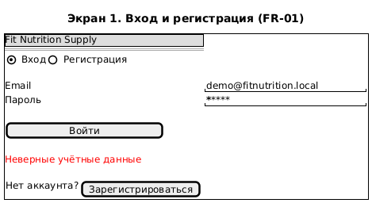
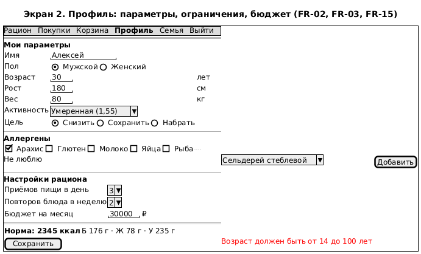
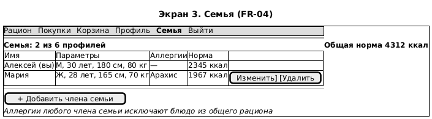
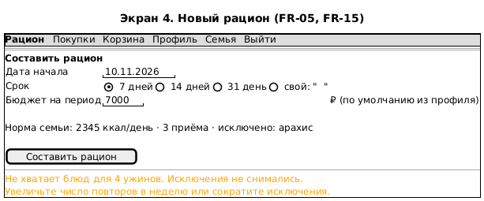
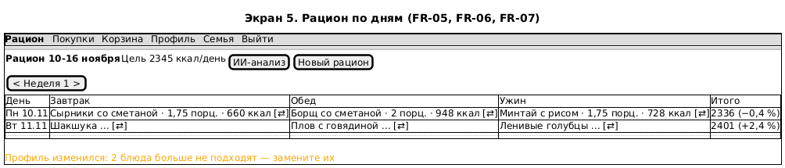
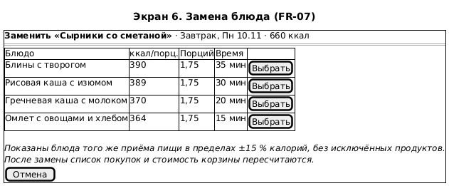
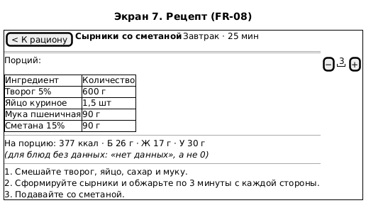
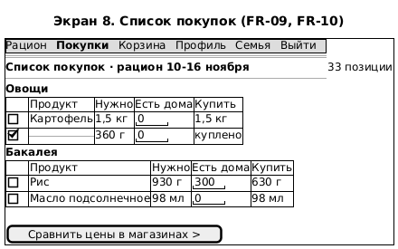
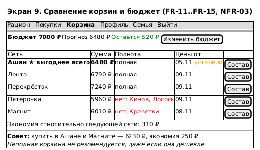
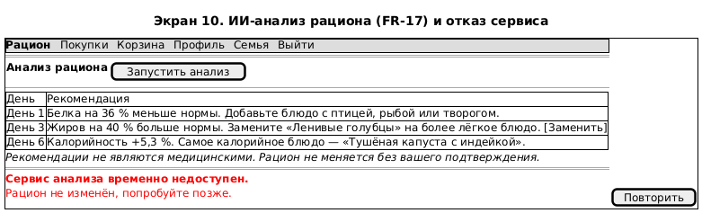

# Wireframe-ы экранных форм

Wireframe-ы нарисованы в PlantUML Salt (`diagrams/wireframes/*.puml`) до начала работы над клиентом. Они фиксируют состав полей, переходы и сообщения об ошибках, но не визуальный стиль. Цифры на экранах взяты из критериев приёмки ЛР 1 и тестовых данных, чтобы при проверке прототипа было с чем сравнивать.

## Навигация

Верхнее меню одинаково на всех экранах после входа: «Рацион», «Покупки», «Корзина», «Профиль», «Семья», «Выйти». Пункты «Покупки» и «Корзина» относятся к текущему рациону. Если рациона ещё нет, они ведут на его создание. Новый пользователь после регистрации попадает сразу в профиль, а после сохранения профиля — на создание рациона, поэтому основной сценарий из ЛР 1 проходит без возвратов назад.

```
Вход/регистрация → Профиль → Новый рацион → Рацион ⇄ Рецепт
                                              ↓  ↘
                                    Замена блюда  ИИ-анализ
                                              ↓
                                     Список покупок → Корзины и бюджет
```

## Экраны

### 1. Вход и регистрация



Вход и регистрация собраны на одной карточке с двумя вкладками. При ошибке сервер возвращает общее сообщение «Неверные учётные данные» и не уточняет, что именно не так, email или пароль (FR-01.3).

### 2. Профиль



Под формой показывается рассчитанная норма. Пользователь сразу видит, к чему привели его параметры, и может проверить число из FR-02 (2345 ккал). Ошибка выводится под конкретным полем.

### 3. Семья



Счётчик «2 из 6» заранее показывает лимит из FR-04. Подсказка внизу объясняет, почему у всей семьи пропало блюдо с арахисом.

### 4. Новый рацион



Пресеты 7, 14 и 31 день покрывают частые случаи, а для остальных есть поле со своим значением. Предупреждение внизу — ответ на FR-05.4: система называет, каких приёмов пищи не хватает, и не снимает исключения сама.

### 5. Рацион по дням



Рацион показан таблицей «день × приём пищи», по неделе за раз. В итоговой колонке видно отклонение дня от нормы. Название блюда открывает рецепт, кнопка ⇄ — замену. Блюда, которые перестали подходить после изменения профиля, подсвечиваются (FR-03.3).

### 6. Замена блюда



Замена открывается модальным окном поверх рациона, чтобы не терять контекст дня. Для каждого варианта указано, сколько порций понадобится для той же калорийности.

### 7. Рецепт



Счётчик порций пересчитывает количества ингредиентов, а КБЖУ на порцию остаётся прежним (FR-08).

### 8. Список покупок



Позиции сгруппированы по категориям. Поле «Есть дома» сразу уменьшает количество в колонке «Купить», а отметка «куплено» зачёркивает строку и исключает её из корзины (FR-10).

### 9. Сравнение корзин и бюджет



Панель бюджета стоит первой: ради неё пользователь и открывает экран. Ниже идут сети: полные корзины сверху, неполные с перечнем недостающих товаров ниже. Если цены сети старше 72 часов, рядом с датой стоит пометка «устарели» (NFR-03).

### 10. ИИ-анализ



Каждая рекомендация привязана к дню рациона. Внизу экрана показаны оба исхода: обычный список рекомендаций и сообщение об отказе сервиса из исключительного сценария.

## Решения, принятые по wireframe-ам

До начала программирования по wireframe-ам приняты три решения, которые потом попали в код. Список покупок не хранится, а выводится из рациона: иначе после каждой замены блюда его пришлось бы синхронизировать вручную. На мобильной ширине таблица рациона превращается в карточки по дням, иначе NFR-05 (360 px без горизонтальной прокрутки) не выполнить. Оформления заказа в сети на экране корзины нет совсем, даже неактивной кнопки, потому что это Won't (FR-20).

Готовые экраны прототипа сняты в [screenshots](screenshots/), их можно сравнить с wireframe-ами.
